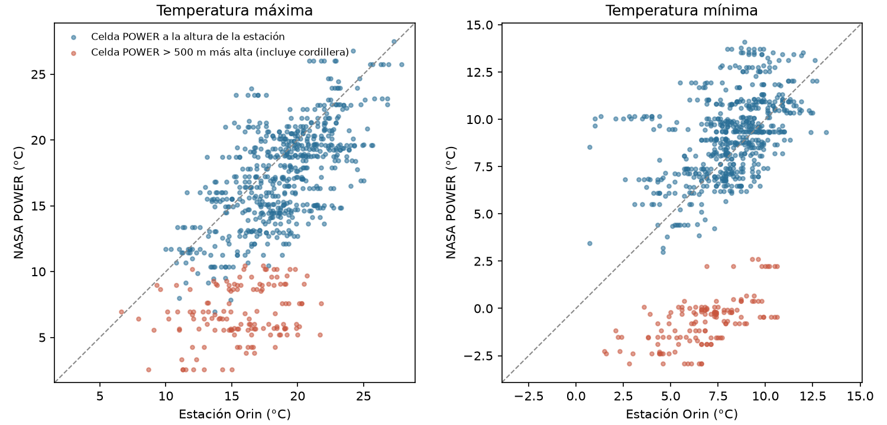

# Qué tan bien ve el satélite tu lote: NASA POWER contra estaciones de Orin

Comparamos la temperatura diaria de **NASA POWER** (lo que usa la app para heladas y calor) con lo que midieron **53 estaciones meteorológicas de Orin** en Mendoza entre el 4 y el 20 de octubre de 2026: 742 pares estación-día por variable. Script: `pipeline/orin_validation.py`. Salida para la app: `orin/validation.json` (contrato 2.9, `synthetic: false`).

## Resultado

| Variable | Pares | RMSE | Sesgo (POWER − estación) | r | Juicio |
|---|---|---|---|---|---|
| Temperatura máxima | 742 | 5,05 °C | −2,82 °C | 0,63 | malo |
| Temperatura mínima | 742 | 3,89 °C | −0,67 °C | 0,46 | malo |

Juicio para temperatura diaria: RMSE ≤ 2 °C bueno, ≤ 3,5 °C regular, más alto malo.

## Por qué: la altura

Una celda de POWER mide unos 55 × 60 km y tiene **una sola altura promedio**. En el Valle de Uco la celda incluye la cordillera: su altura media es de **2.485 m**, mientras que las estaciones están entre 1.000 y 1.500 m. Por eso POWER da allí **6,7 °C menos** de máxima. Son 10 de las 53 estaciones, los puntos rojos del gráfico.

| Variable | Todas las estaciones | Sin las 10 de la celda con cordillera | Todas, corrigiendo por altura (6,5 °C/km) |
|---|---|---|---|
| Máxima, RMSE | 5,05 °C | 3,32 °C | 2,82 °C |
| Mínima, RMSE | 3,89 °C | 2,31 °C | 2,28 °C |

## Qué significa para el productor

- En llanura (zona Este y Sur de Mendoza, y la región pampeana) POWER sirve para ver **patrones**: estaciones del año, olas de calor, ventana libre de heladas.
- En valles de montaña POWER puede errar varios grados, y eso pesa en las heladas: un error de 2–3 °C en la mínima cambia si la noche hiela o no.
- **Satélite y estación se complementan.** El satélite da 25 años de historia en cualquier punto; la estación da el valor exacto en el lote. Corregir el dato satelital con la altura real del lote (SRTM) ya reduce el error casi a la mitad; calibrarlo con una estación cercana lo reduce más.
- Para decisiones de helada en un lote puntual: **confirmá con una estación cercana o con tu agrónomo**.

## Limitaciones

- Solo 14 días de octubre de 2026. Es poco para estimar un sesgo estacional; con más historia de Orin se puede calibrar por estación y mes.
- Los días de octubre de 2026 en POWER salen de GEOS-IT, no de MERRA-2 (ver `docs/decisions.md`).
- 1 estación no tiene altura en el catálogo y queda fuera de la corrección por altura.
- **No se valida NDVI ni humedad del suelo:** el NDVI de Orin también es satelital (Sentinel-2) y la cuenta no tiene muestreos de campo. No hay medición de suelo contra qué comparar, así que esas filas no se publican.

## Archivos

- `pares_estacion_dia.csv`: cada par, con la altura de la estación y la de la celda POWER.
- `metricas.json`: métricas crudas, corregidas por altura y por zona.
- `satelite_vs_estaciones.png`: gráfico para el video.
